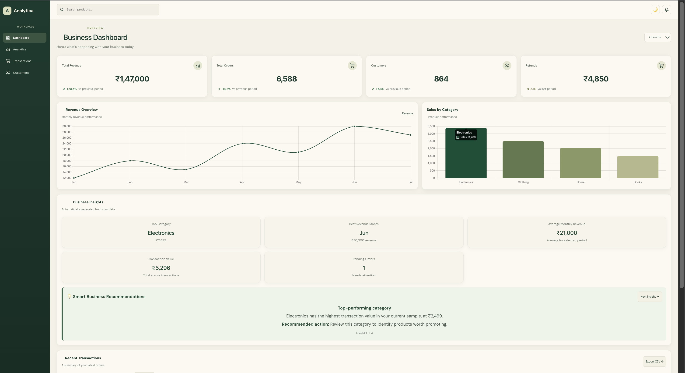

# Analytica — Business Intelligence Dashboard

**An interactive business analytics dashboard built with React, Vite, and Chart.js.**

Explore sales trends, monitor business KPIs, filter transactions, and discover actionable insights through a clean, responsive interface.

### 🔗 Links

- **Live Demo:** [Open Analytica](https://analytics-dashboard-two-flame.vercel.app/)
- **Source Code:** [GitHub Repository](https://github.com/suhanasristy12345-bot/analytics-dashboard)

---

## 📊 Features

- **Business KPIs:** Revenue, orders, customers, and growth comparisons.
- **Interactive Charts:** Monthly revenue trends and category sales analysis.
- **Period Selection:** Switch between the available 30-day, 90-day, and 7-month views.
- **Business Insights:** Explore the strongest revenue month, average monthly revenue, top category, and pending orders.
- **Dynamic Recommendations:** Cycle through generated business insights and suggested actions.
- **Transaction Search:** Search transactions by product name.
- **Filtering:** Filter transactions by category and status.
- **CSV Export:** Export transactions matching the current search and filters.
- **Dark Mode:** Switch between light and dark themes.
- **Responsive Design:** Supports desktop, tablet, and mobile screens.

## 🛠️ Tech Stack

- React
- Vite
- JavaScript
- Chart.js
- react-chartjs-2
- Lucide React
- CSS

## 🚀 Getting Started

### Prerequisites

Install [Node.js](https://nodejs.org/) and npm.

### Installation

Clone the repository:

```bash
git clone https://github.com/suhanasristy12345-bot/analytics-dashboard.git
cd analytics-dashboard
```

Install dependencies:

```bash
npm install
```

Start the development server:

```bash
npm run dev
```

Open the local URL displayed in your terminal.

### Production Build

```bash
npm run build
```

## 📁 Project Structure

```text
analytics-dashboard/
├── public/
├── src/
│   ├── assets/
│   ├── App.jsx
│   ├── App.css
│   ├── index.css
│   └── main.jsx
├── index.html
├── package.json
└── README.md
```

## 📌 Data Disclaimer

This project uses sample data for demonstration. The dashboard is not currently connected to a live business database.

## 🔮 Future Improvements

- Integrate a real data source or API.
- Add customizable date ranges.
- Expand analytics and reporting.
- Add automated testing and accessibility improvements.

## 👨‍💻 About

Analytica is a portfolio project demonstrating interactive dashboard development, business data visualization, and responsive front-end design.

**Built with React. Visualized with Chart.js. Deployed on Vercel.**


